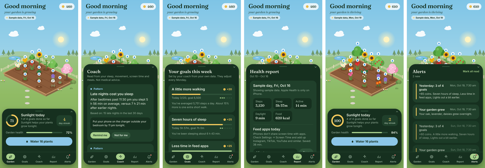

> **Try the jury demo on your phone:** [Mac + Windows + Expo Go — English](docs/EXPO_GO_EN.md) · [Türkçe sıfırdan kurulum](docs/EXPO_GO_TR.md). Clone the separate `demo/jury-month` branch. No API key is needed for the prepared replay.

> **Jury preview branch:** See [the 30-day demo guide](docs/JURY_DEMO.md) for the empty-first UI, real-data provenance, video script and safe teammate setup. `main` keeps the original version.

# 🌱 Healthy Garden

> **Grow Yourself. Grow Your Garden. Grow a Better World.**

Healthy Garden reads your phone and watch data — steps, sleep, runs, time outside, meals and
time spent in feed apps — and an AI coach turns it into **personal** weekly goals and
suggestions. Every goal you hit brings sunlight and coins to a calm little garden that grows
with you. Plants never die; they rest until you come back.

<p align="center"></p>

## Try it in 3 steps (no accounts needed)

You need an iPhone (or Android phone) with **Expo Go** from the App Store / Play Store, and a
computer with **Node.js LTS** and **Git**. Phone and computer on the same Wi-Fi.

**Mac (Terminal)**
```bash
git clone https://github.com/MertDemircanYc80/healthy-garden.git
cd healthy-garden/mobile && npm ci
npx expo start            # scan the QR code with the iPhone camera
```

**Windows (Command Prompt)**
```bat
winget install OpenJS.NodeJS.LTS
winget install Git.Git
:: close and reopen Command Prompt, then:
cd %USERPROFILE%
git clone https://github.com/MertDemircanYc80/healthy-garden.git
cd healthy-garden\mobile
npm ci
npx expo start
```

Different networks, or the QR won't connect? Use `npx expo start --tunnel`.

The app opens in **demo mode**: a sample persona's 30 days of phone and watch data. Tap the
**Sample data** pill under the greeting and press **Next day** to watch goals get hit, coins
arrive and the garden grow.

## How it works

```
Apple Health (steps, sleep, workouts, daylight, meals) ─┐
Screen time (typed in; iOS doesn't share it with apps) ─┼─► health_days (Supabase, per user, RLS)
                                                         │
             Edge Function "analyze" ◄───────────────────┘
               1. computes facts in code (averages, week-over-week, late nights vs sleep,
                  feed time vs bedtime, weekdays vs weekends, short drives, protein on run days)
               2. Claude writes goals, coach suggestions, report summary and alerts that may
                  only cite those facts (Structured Outputs)
               3. a validator enforces ranges and safety (no diagnoses, no diet restriction)
                                                         │
             goals · insights · reports · alerts ◄───────┘──► the app's island sections
```

- **App:** Expo SDK 57 + React Native, Expo Router, react-native-svg (the garden is drawn in code)
- **Apple Health:** `@kingstinct/react-native-healthkit` with background delivery (needs a development build; Expo Go shows sample data)
- **Backend:** Supabase — anonymous sign-in (no login screen), Postgres with row-level security, Edge Functions
- **AI:** Claude (`claude-sonnet-5-5`) with Structured Outputs; without a key a rule-based coach writes the same kind of output from the same facts

## Repository map

| Path | What |
|---|---|
| `mobile/` | The iPhone app (Expo). See [`mobile/README.md`](mobile/README.md) |
| `supabase/migrations/` | Database schema with RLS — [`docs/SUPABASE_SETUP.md`](docs/SUPABASE_SETUP.md) |
| `supabase/functions/analyze/` | AI coach Edge Function; logic + tests in `supabase/functions/_shared/analysis/` |
| `supabase/seed/demo_health_days.csv` | The demo persona's data, for seeding a Supabase demo user |
| `docs/SUBMISSION.md` | Demo video script and submission checklist |
| `src/` (root) | First web prototype (frozen, kept for reference) |

## Tests

```bash
cd mobile && npm run check && npm run typecheck          # health parsing + demo week
cd supabase/functions && deno test --allow-env _shared/analysis/   # AI coach pipeline
```

## Privacy and honesty

- Only daily totals are stored — never message content, browsing history or locations.
- Demo mode uses a synthetic persona generated by `mobile/scripts/make-demo-data.ts`; it is labelled "Sample data" in the app.
- Healthy Garden is not medical advice. Tree planting shown in earlier prototypes is a mock-up.

## Team

Built at a hackathon by Mert and teammates, with Claude as a coding assistant. Contributor and
AI-assistant rules: [`AGENTS.md`](AGENTS.md).

## Free-tier AI and terminal demo

[Turkish setup + week-by-week recording guide](docs/AI_TERMINAL_TR.md): Gemini key setup, terminal imports for days 7/14/21/28/30, daily rewards and manual garden care. Keys stay local; the live provider must be verified with your own key.
