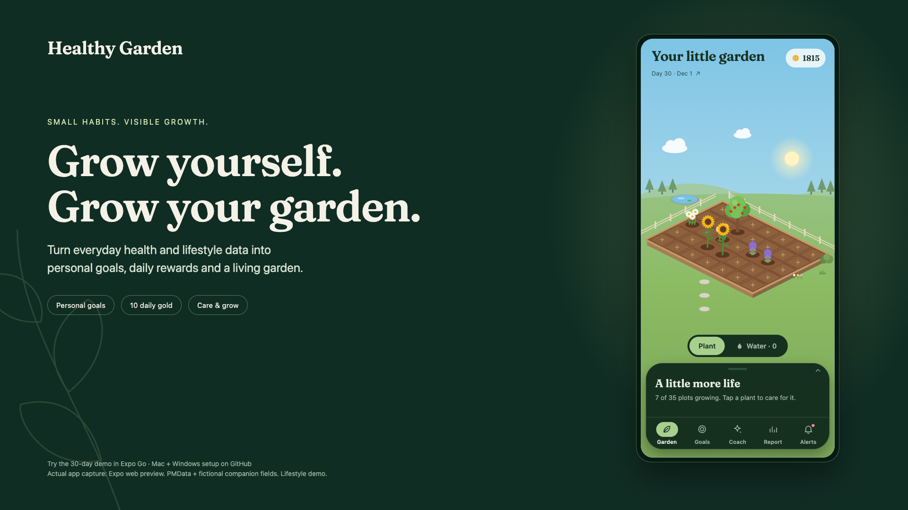

# Healthy Garden — jury media kit

[**Download the 1:15 demo (MP4)**](healthy-garden-demo.mp4) · [Editable English captions (SRT)](healthy-garden-demo.srt)

The video is **1:14.92**, **1920 × 1080**, H.264 MP4 at 50 fps with stereo AAC audio and English chapter titles and explanations baked into the picture. It records the **running Expo web version of the mobile app** at a phone viewport, framed for a jury presentation. It is an actual UI recording: reports, goals, purchases, water use, daily rewards and plant growth run through the app's normal code. This shorter edit removes long holds and blank capture frames. Key foreground sequences play at their recorded speed; repeated care becomes a short 1.5–2× montage. No scene is slowed down or extended with a held frame. The source recording is 25 fps; the 50 fps export also retains motion during accelerated care. A closing care clip continues from the same recorded wallet/plants/inventory/receipts, then uses real purchases and watering.

The audio is original sound design made for this demo: a quiet warm underscore, soft clicks, upward panel sweeps, gold chimes and water drops, with a short entry/exit fade. No third-party music or stock audio is included.

## Chapters

| Time | Scene |
| --- | --- |
| 0:00 | A month of small steps |
| 0:03 | End of the first day — 10 daily gold |
| 0:07 | End of the first week — sleep and Instagram reports |
| 0:13 | Personal AI goals and explanations |
| 0:20 | Buy, plant and water |
| 0:27 | Day 8 rewards and daily care montage |
| 0:41 | Following weeks and garden growth |
| 1:03 | One month later — report and cared-for garden |

## Promotional images

| Asset | Size | Use |
| --- | --- | --- |
| [Landscape](healthy-garden-promo-landscape.png) | 1920 × 1080 | Presentation cover, video thumbnail |
| [Square](healthy-garden-promo-square.png) | 1080 × 1080 | Social post |
| [Story](healthy-garden-promo-story.png) | 1080 × 1920 | Vertical story |
| [Understand → act → grow](healthy-garden-promo-loop.png) | 1920 × 1080 | Product overview |

## What is shown

- First-week observation is rewarded at **10 gold per completed day**, with no AI-goal rewards before goals exist.
- Completed goals pay **2×** the base reward written in the AI plan. No duplicate daily payouts occur on reload/import.
- Recording days 7, 14 and 21 use **saved results from genuine Gemini requests**. The final checkpoints (28 and 30) use the included **Prepared AI** analyses because live calls hit free-tier limits. The app displays each source; the video does not claim a fresh live request for every scene.
- Wearable values come from **PMData participant p01** under **CC BY-NC 4.0**, for this educational hackathon demo. Phone usage, daylight and food are explicitly fictional companion fields. [Data attribution and raw-source hashes](../datasets/README.md).
- The garden graphics are the project's SVG assets; promotional layouts use actual app captures and the app's Fraunces typeface. No invented app screens or third-party stock imagery are used.
- This demonstrates the prototype's data → plan → goals → rewards → care loop. It does not demonstrate native HealthKit/Screen Time synchronization, an actual MyFitnessPal connection, plant discounts or a clinical health intervention.

Try it yourself: [Mac + Windows + Expo Go](../docs/EXPO_GO_EN.md) · [Türkçe kurulum](../docs/EXPO_GO_TR.md).
